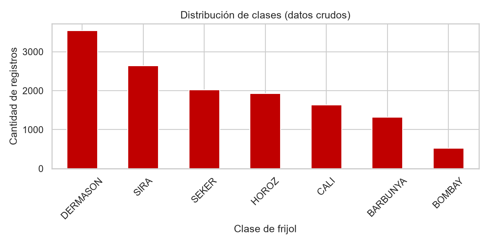
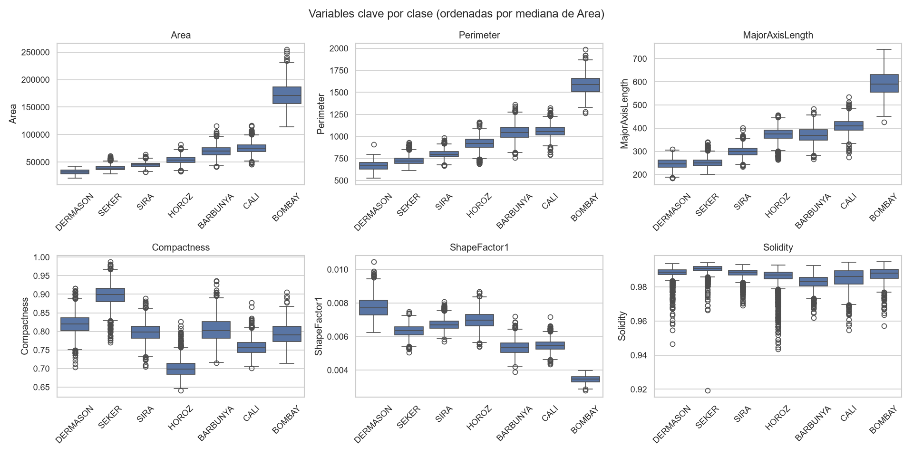
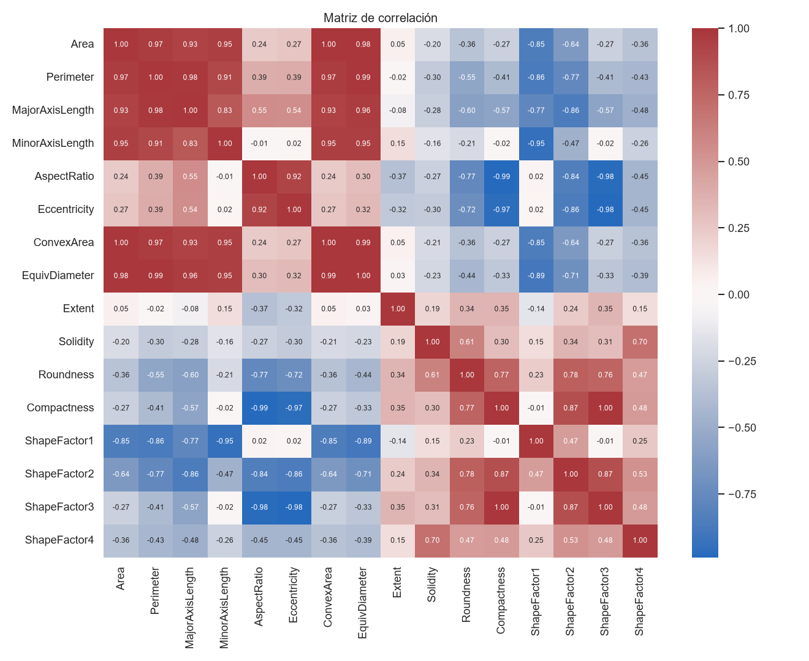

# Sección 2 · Comprensión de los datos

*Borrador del Data Engineer / Analyst · Fase 2 de CRISP-DM. Evidencia: [notebook 01](../../notebooks/01_comprension_preparacion_datos.ipynb) y [diccionario de datos](../diccionario_datos.md).*

## 2.1 Fuente y tamaño

Los datos son el **Dry Bean Dataset** del repositorio UCI (id 602). Cada fila es un grano de frijol seco fotografiado; un programa de visión por computador midió su forma y su tamaño. El conjunto tiene **13.611 granos y 17 columnas**: 16 características numéricas y la variedad (`Class`).

## 2.2 Variables

| Grupo | Cantidad | Ejemplos | Qué describen |
|---|---:|---|---|
| Tamaño | 6 | `Area`, `Perimeter`, `MajorAxisLength` | Cuánto mide el grano, en píxeles |
| Forma | 10 | `AspectRatio`, `Roundness`, `Solidity`, `ShapeFactor1` a `4` | Qué tan alargado, redondo o compacto es |

Dos columnas son enteras (`Area` y `ConvexArea`) y el resto decimales. La única columna que no es numérica es `Class`. Significado y fórmulas: [diccionario de datos](../diccionario_datos.md).

## 2.3 Variable objetivo y balance de clases

La tarea es de **clasificación multiclase**: predecir una de siete variedades.

| Variedad | Granos | % |
|---|---:|---:|
| DERMASON | 3.546 | 26,1 |
| SIRA | 2.636 | 19,4 |
| SEKER | 2.027 | 14,9 |
| HOROZ | 1.928 | 14,2 |
| CALI | 1.630 | 12,0 |
| BARBUNYA | 1.322 | 9,7 |
| BOMBAY | 522 | 3,8 |

**Las clases no están balanceadas:** DERMASON tiene unas 6,8 veces más granos que BOMBAY. Con este desbalance, un modelo podría acertar mucho en general y fallar en las variedades pequeñas, por eso la métrica principal del proyecto es el **F1 macro**, que da el mismo peso a cada variedad.

## 2.4 Calidad de los datos

| Aspecto | Resultado | Decisión |
|---|---|---|
| Valores nulos | **0** en todas las columnas | No hay nada que imputar |
| Filas duplicadas | **68**, todas de la variedad HOROZ | Se eliminan (ver sección 3) |
| Valores atípicos (regla IQR) | 7.139 valores en total, repartidos entre las variables | Se **conservan**: son mediciones físicas reales |

El conteo de atípicos cambia de 7.139 a 7.152 al quitar los duplicados; no es un error, es la suma de dos efectos (−35 que estaban en las filas repetidas y +48 por recalcular los cuartiles). Detalle en el notebook 01, sección 5.1.

## 2.5 Relaciones entre variables

Varias variables se calculan a partir de otras, por lo que se mueven juntas:

- Las de tamaño casi coinciden: `Area` y `ConvexArea` (correlación ≈ 1,00), `Perimeter` y `EquivDiameter` (0,99).
- `Compactness` y `ShapeFactor3` también (≈ 1,00).

## 2.6 Qué implica para el modelado

1. Usar **F1 macro** y separar train y test de forma **estratificada**, por el desbalance.
2. Quitar duplicados **antes** de separar, para que un mismo grano no quede en ambos conjuntos.
3. La alta correlación no afecta a los árboles, pero puede volver inestables los coeficientes de la regresión logística: tenerlo presente al interpretarla.
